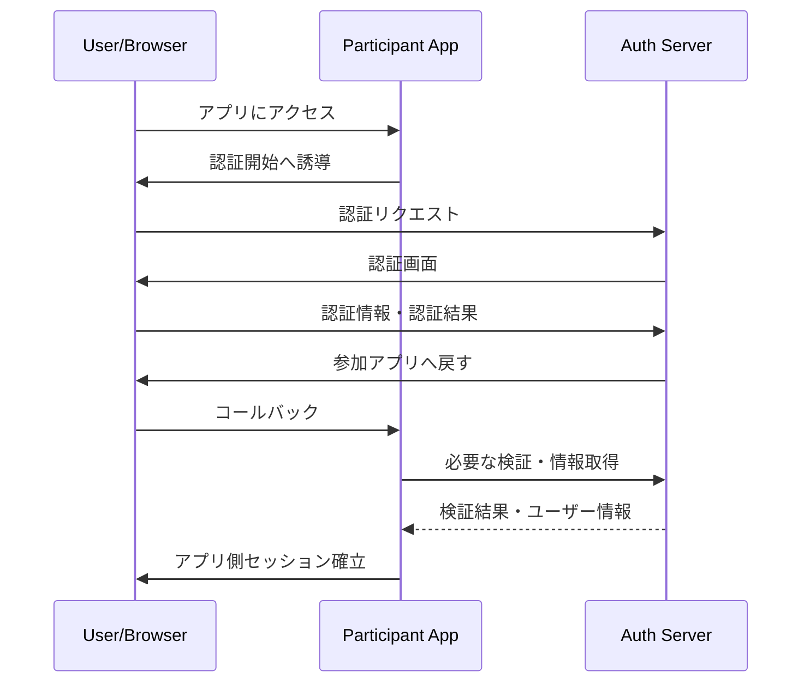

# Integration Flow

## 1. 目的

参加アプリと認証サーバー間の代表的な連携フローを図示し、実装・テストの共通理解を作る。

## 2. 認証フロー（概念図）

この図は概念図であり、実際の通信回数・エンドポイント・ブラウザを介する情報は実装仕様に合わせて更新する。

## 3. 必ず明確にする事項

- リクエストと応答の紐付け
- コールバックURLの検証
- 認証結果の検証主体と方法
- ユーザー識別子の扱い
- タイムアウト・リプレイ対策
- エラー時の遷移
